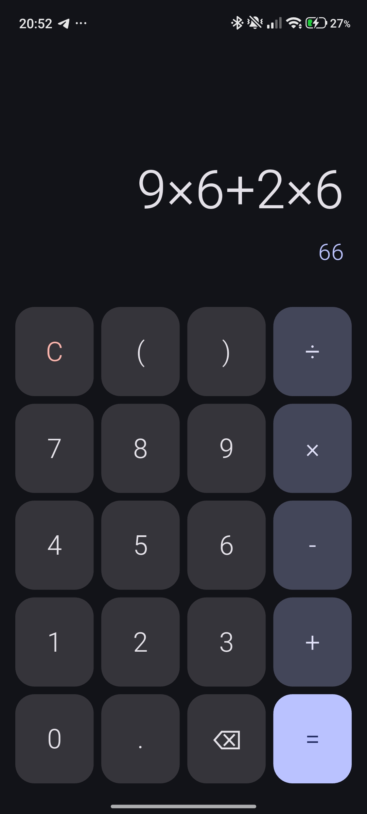

# Calculadora

Calculadora móvil para Android e iOS hecha con **Flutter**. El motor de cálculo está escrito desde cero (sin librerías de evaluación) y separado de la interfaz.

## Capturas



## Funciones

- Operadores `+`, `-`, `×`, `÷` con **precedencia correcta** (`2 + 3 × 4 = 14`)
- Paréntesis anidados y números decimales
- Números negativos (`-5 + 3`, `2 × (-4)`)
- Vista previa del resultado mientras escribes
- Errores controlados: división entre cero, paréntesis sin abrir o cerrar, expresión incompleta
- Interfaz con Material 3 y tema oscuro

## Cómo funciona el motor

El cálculo se hace en tres etapas, en `lib/engine/calculator_engine.dart`:

1. **Tokenizador:** convierte el texto en números, operadores y paréntesis.
2. **Shunting-yard:** reordena los tokens a notación postfija (RPN) aplicando precedencia y asociatividad. Los menos unarios se tratan como un operador aparte.
3. **Evaluación con pila:** resuelve la expresión postfija y lanza `CalculatorException` ante cualquier error.

## Estructura del proyecto

```
lib/
  engine/calculator_engine.dart   # lógica de cálculo (sin dependencias de UI)
  ui/calculator_screen.dart       # pantalla y botones
  main.dart                       # punto de entrada
test/
  calculator_engine_test.dart     # pruebas unitarias del motor
```

## Cómo ejecutarla

Requisitos: [Flutter SDK](https://docs.flutter.dev/get-started/install) y un dispositivo Android o iOS (o Chrome).

```
git clone https://github.com/TU_USUARIO/calculadora.git
cd calculadora
flutter pub get
flutter run
```

## Pruebas

```
flutter test
```

## Descarga

El APK de Android está disponible en la sección [Releases](https://github.com/TU_USUARIO/calculadora/releases).

## Próximas mejoras

- Modo científico (potencia, raíz, trigonometría, logaritmos)
- Historial de operaciones
- Botón de cambio de signo (±) y porcentaje

## Autor

[Jose Luis Cajahuanca](https://https://github.com/kjawank-jose)